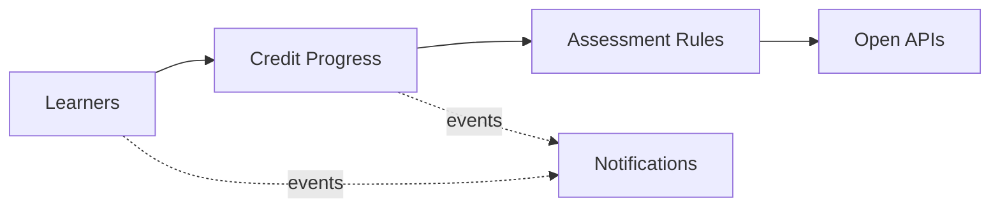

# Domain Model and Bounded Contexts

Ubiquitous language and context design (view VP-4). Domain-standard concepts are mapped
normatively in `../domain/domain-standards.md` (CR-5).

## Ubiquitous language (selected terms)

| Term | Meaning |
|---|---|
| **Learner** | An enrolled person; the institutional identifier is masked by construction |
| **Credit progress** | A learner's remaining-credits account for a program |
| **Credit award** | One award of credits (course, lab, project, exam) against the remaining balance |
| **Assessment rule** | A decision rule binding a study level to attempts and integrity envelopes |
| **Course** | A catalogue course with a credit value |
| **Engagement risk score** | A transparent 0-100 early-warning score from engagement signals |

## Bounded contexts and invariants

### Learners — `learner-service`
Learner registry; the institutional identifier is masked at enrolment. Lifecycle: `ENROLLED` → transitions
suspend, graduate. Learner identifiers are validated at enrolment and never stored or returned in clear — only a masked form is kept. Learning records are personal data: minimized, pseudonymized by UUID in events, and all data here is synthetic.

### Credit Progress — `progress-service`
Remaining-credits accounts per learner and the credit awards against them. **Invariant (ADR-0004): credits awarded to a learner never exceed the program's required total — an award that would overrun it is rejected (422) and records nothing; the remaining-credits balance never goes negative.** Consumption records are
append-only evidence; a rejected operation records nothing.

### Assessment Rules — `assessment-rules-service`
Decision rules binding study levels to attempt limits and integrity envelopes. Only ACTIVE rules decide; evaluation order is by priority; every decision
is ALLOWED / DEGRADED / DENIED with the matched rule and a human-readable reason.

### Courses — `course-catalog-service`
Course catalogue with credit values and modalities.

### Notifications — `notification-service`
Delivery trail for audit; recipients are never logged.

## Context map

